

<a href="https://karyalay.skotechlabs.com">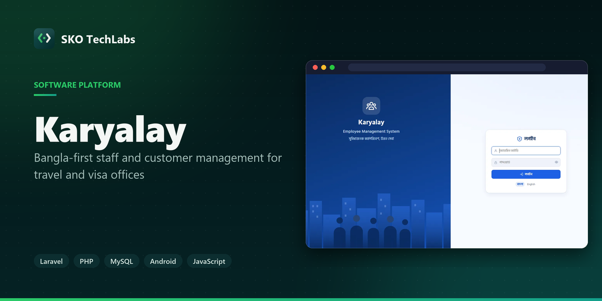</a>

<h3>Bangla-first staff and customer management for travel and visa offices</h3>

A Bangla-first system for service offices: staff records, customer applications with PDF documents, tasks and follow-ups, automatic SMS and alerts, a supervision dashboard, Bangla PDF reports, nightly backups, and an online or offline work mode for officers on the move.

   

<a href="https://karyalay.skotechlabs.com"><b>Live Demo</b></a> &nbsp;·&nbsp; <a href="https://skotechlabs.com/projects/karyalay-staff-customer-service-management"><b>Case Study</b></a> &nbsp;·&nbsp; <a href="https://skotechlabs.com/contact"><b>Request a Demo</b></a> &nbsp;·&nbsp; <a href="https://github.com/skotechlabs"><b>All Products</b></a>

---

## Overview

Karyalay replaces the register, the WhatsApp reminders and the loose PDF folders of a travel or visa consultancy. Every customer application keeps its documents, status, notes, calls and SMS in one place, and the admin can see who is doing what and what is stuck.

Routine follow-up runs by itself with plain rules, no AI: when an application is received, when documents are still missing, when a case has not moved for days or a task is overdue, the system texts the customer, creates a task or alerts the officer and the admin. The rules, the SMS texts, the services and the documents each service needs are all edited from the admin panel.

Officers can work online, or switch the office to an offline-tolerant mode: customers and applications are kept on the phone, locked with a PIN, and everything syncs when the phone is back online. A change that clashes with someone else's is never overwritten; it waits for the admin to decide. The live demo gives every visitor a private copy to try, with passwords, logins, backups and the SMS gateway locked.

<table>
<tr>
<td width="50%" valign="top">

### The Challenge

A small consultancy runs on phone calls, WhatsApp messages and a register: customer documents live in chat history, nobody knows which file is stuck, and officers forget the follow-up call. The owner needed one place to see the whole office, in Bangla, on a small budget, with a phone app for officers who are not always at their desk and a clear path to automation later.

</td>
<td width="50%" valign="top">

### Our Solution

We built a Laravel web app with a phone-first interface and a rule engine that does the routine work: it watches statuses, documents and deadlines and then texts, creates tasks or raises alerts. Customer data is private by default, documents never sit in a public folder, and every important action is written to an audit log. For officers who work away from the office, an offline desk keeps their customers on the phone behind a PIN and syncs with conflict protection. Bangla PDFs are produced with proper conjunct shaping.

</td>
</tr>
</table>

## Key Features

- Admin and officer logins; an officer only sees the customers and applications that are theirs
- Staff records with ID card, emergency contacts and joining date, plus a work summary for every officer
- Customer applications with up to six PDF documents, a per-service checklist and an incomplete-documents list
- Tasks and a daily schedule for every officer, with overdue and due-soon reminders
- Rule-based automation (no AI): SMS to customers, tasks and alerts when a status changes, documents are missing or a case is stuck
- SMS through any provider with an HTTP API, editable Bangla templates and a character/segment counter
- Click-to-call with a quick call log, and WhatsApp links with the customer already filled in
- Supervision dashboard: work per officer, stuck cases, overdue tasks, documents waiting and recent activity
- Bangla PDF documents and reports: application slip, staff profile, monthly summary, officer work report, customer list
- Offline-tolerant work mode: encrypted offline desk on the phone, queued changes, safe sync and an admin queue for clashes
- Nightly database backup, weekly full backup with documents and an optional copy to another server
- Android app for officers, installable APK handed over to the owner

## Business Impact

- One screen shows every application, its documents and its next step
- Customers get a text at each stage without anyone typing it
- Stuck cases and late tasks surface on their own instead of being found by chance
- Officers keep working without internet and nothing is lost or overwritten at sync
- A live demo where every visitor gets a private copy and nothing sensitive can be changed

## Screenshots

<table>
<tr>
<td width="50%" valign="top">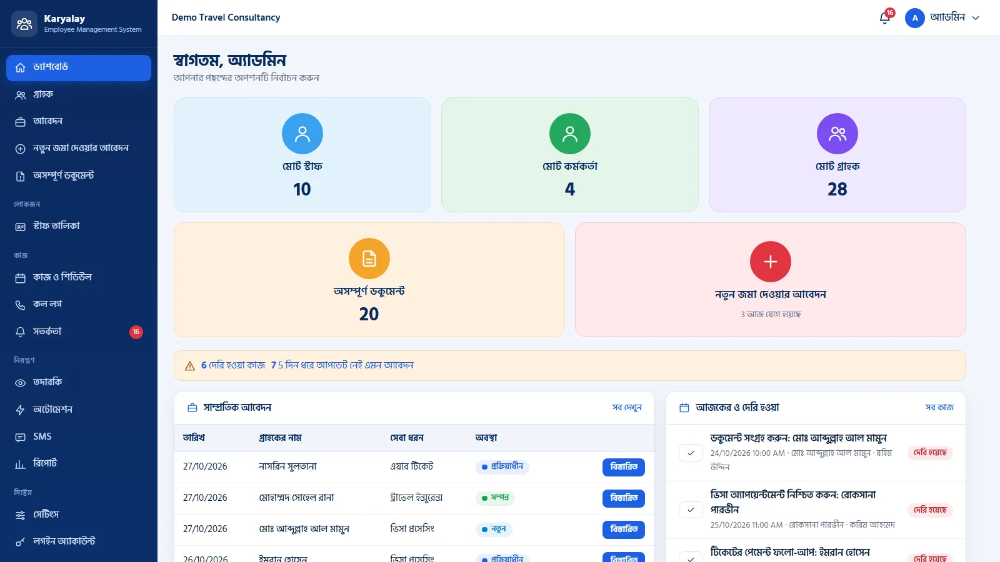 Dashboard: total staff, officers, customers, incomplete documents and a new application in one tap</td>
<td width="50%" valign="top">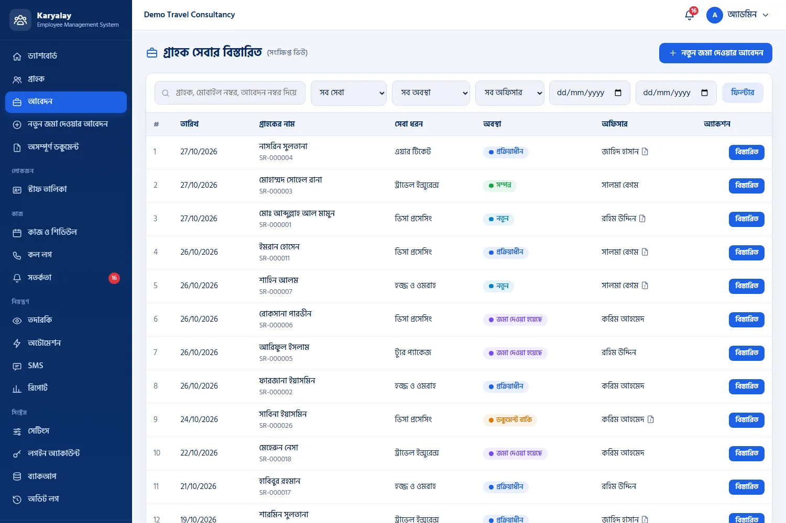 Customer service list with filters by service, status, officer and date</td>
</tr>
<tr>
<td width="50%" valign="top">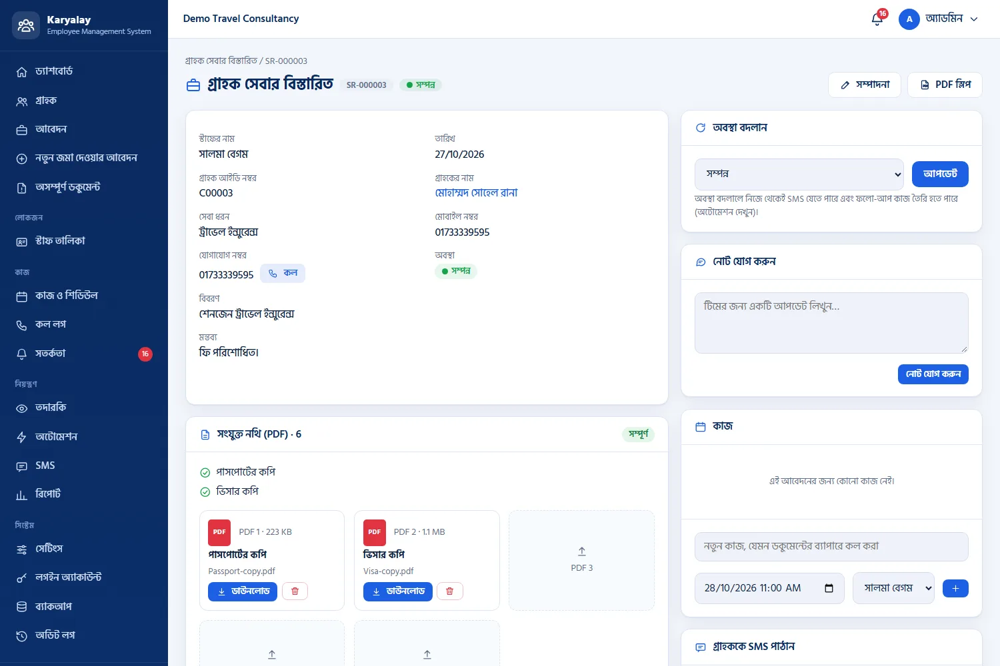 Application details: document checklist, PDF slots, history, tasks and SMS</td>
<td width="50%" valign="top">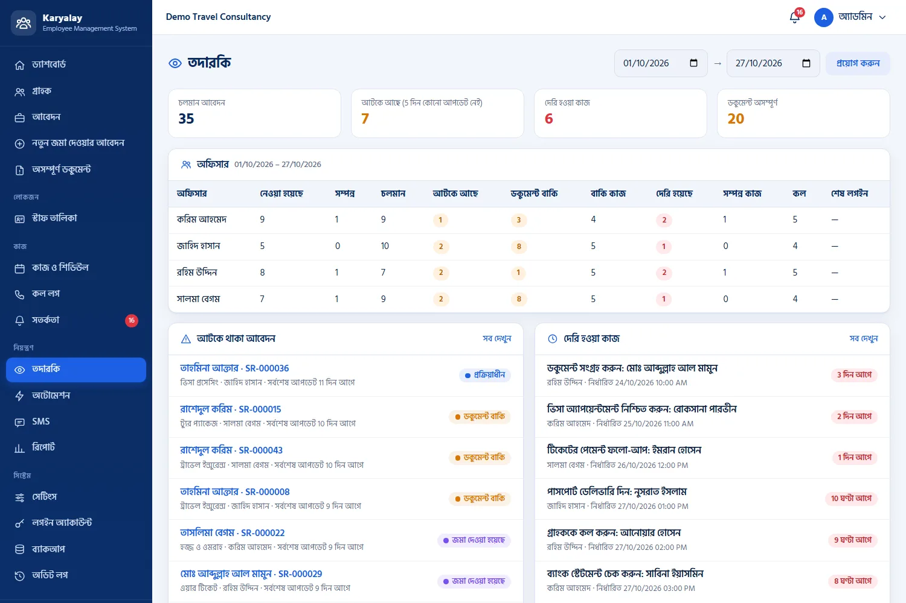 Supervision: work per officer, stuck cases, overdue tasks and documents waiting</td>
</tr>
<tr>
<td width="50%" valign="top">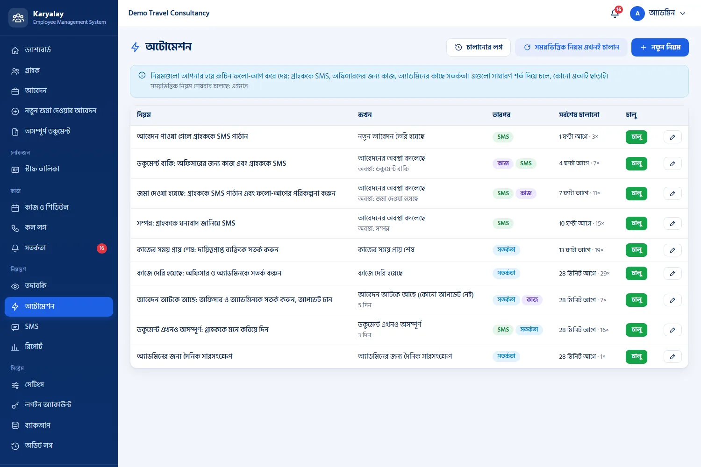 Automation rules written as plain conditions: when this happens, do that</td>
<td width="50%" valign="top">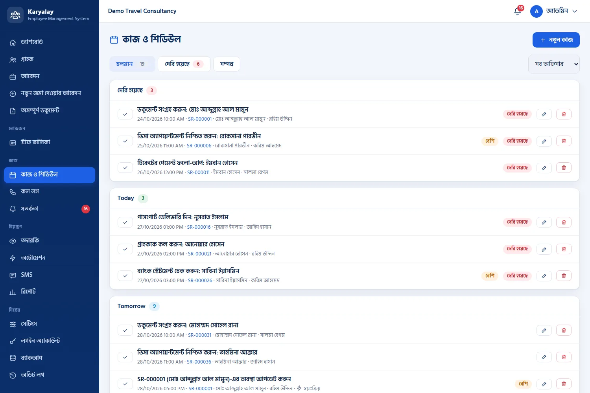 Tasks and schedule for every officer, with overdue and due-soon reminders</td>
</tr>
<tr>
<td width="50%" valign="top">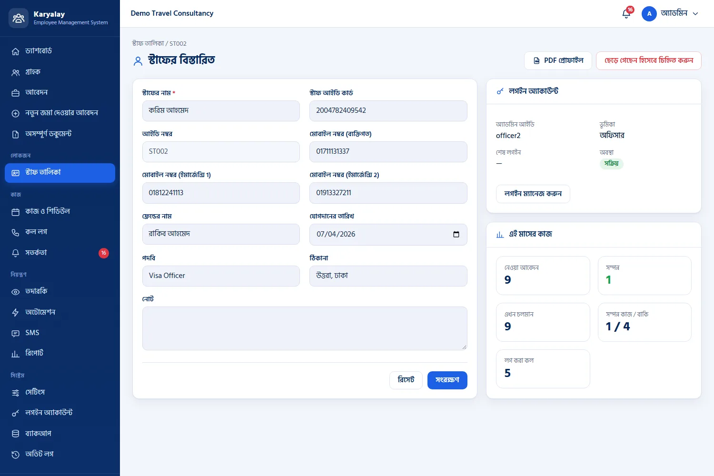 Staff details with ID card, emergency contacts, joining date and login</td>
<td width="50%" valign="top">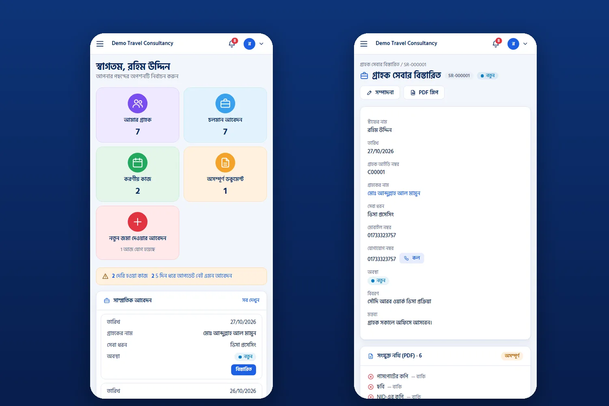 Phone screens for officers: dashboard and application details</td>
</tr>
<tr>
<td width="50%" valign="top">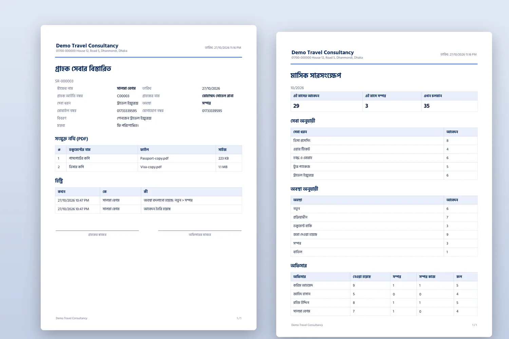 Bangla PDF documents: application slip and monthly summary</td>
<td width="50%" valign="top">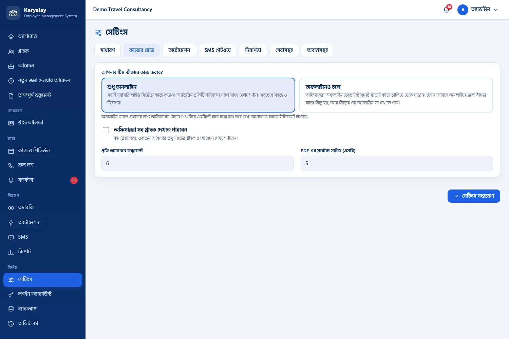 Work mode: online only, or offline-tolerant for officers on the move</td>
</tr>
<tr>
<td width="50%" valign="top">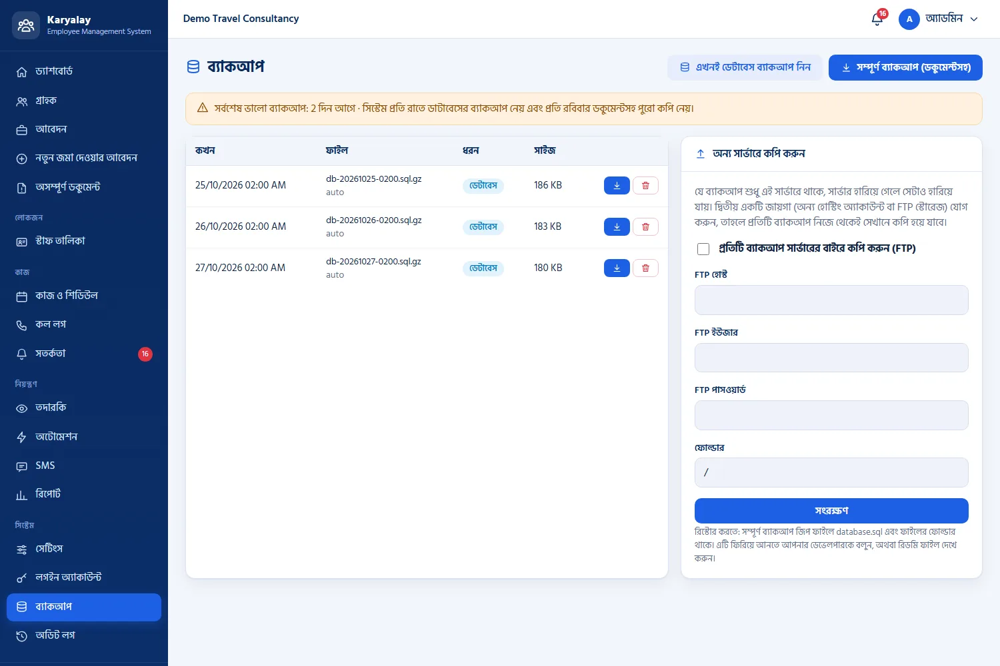 Backups: nightly database copy, weekly full copy with documents and an off-server copy</td>
<td width="50%"></td>
</tr>
</table>

> See it running: **[karyalay.skotechlabs.com](https://karyalay.skotechlabs.com)**

## Technology Stack

## Source Code & Licensing

This repository is the public showcase for **Karyalay**. The production source code is proprietary and is maintained privately by SKO TechLabs.

Interested in this product for your business? We offer:

- **Ready-to-launch deployment** of Karyalay under your own brand and domain
- **Customisation** of features, workflows, languages and integrations to fit how you work
- **Custom development** of a new product built on the same foundations
- **Ongoing support**, hosting, maintenance and feature roll-outs after launch

## Get in Touch

---

© 2026 <a href="https://skotechlabs.com">SKO TechLabs</a> · Dhaka, Bangladesh · Building intelligent digital solutions

